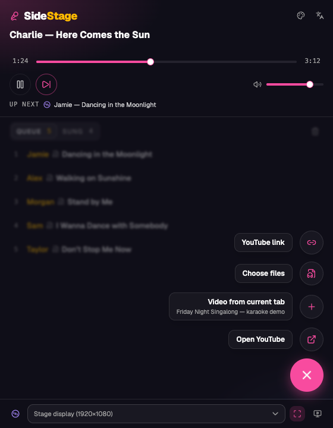
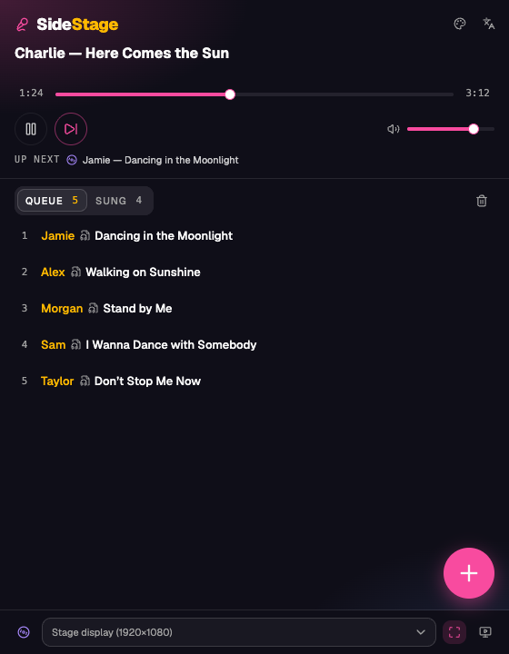
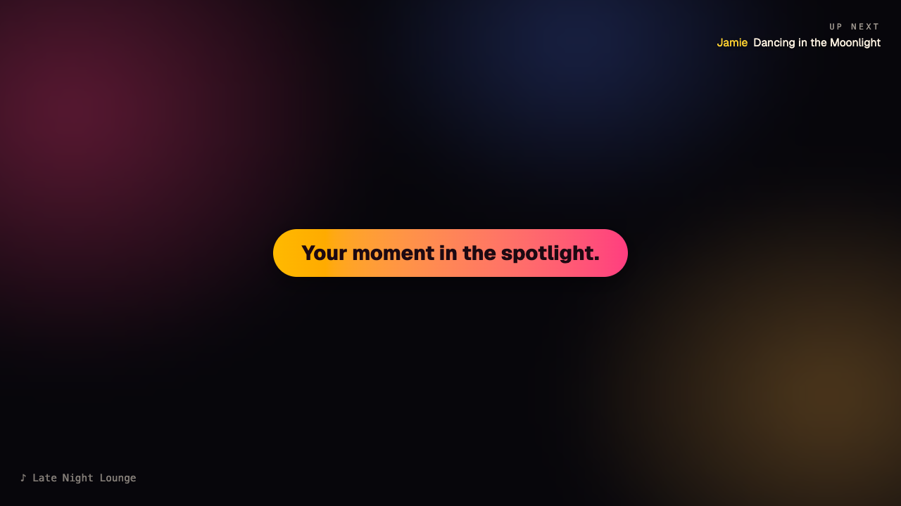
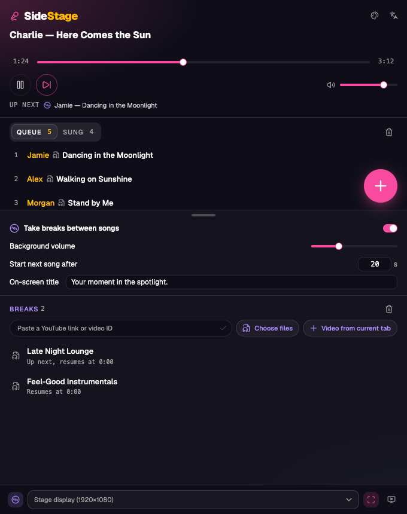

# User guide

[Back to SideStage](../README.md)

- [Install](#install)
- [Add songs](#add-songs)
- [Manage the queue](#manage-the-queue)
- [Set up the player](#set-up-the-player)
- [Take breaks](#take-breaks)
- [Keyboard access](#keyboard-access)
- [Your data](#your-data)

Screenshots show the interface with sample songs and singer names.

## Install

1. Clone this repository and build the extension (see [Development](development.md)):

   ```sh
   cd dashboard
   npm ci
   npm run build
   ```

2. Open `chrome://extensions` and enable **Developer mode**.
3. Choose **Load unpacked** and select the `extension/` directory.
4. Click SideStage’s toolbar button to open the console.

The built files are not committed, so a fresh clone needs Node.js for the build
step. Rebuild and reload the extension and any open YouTube tabs after updating.
Use your normal browser session to sign in to YouTube when needed.

## Add songs



On YouTube, use **+ Queue** on a thumbnail or the queue button on a watch page.
In the side panel, open **+** and choose **YouTube link**, **Choose files**, or
**Video from current tab**. You can paste a YouTube URL or video ID, or drop
links and local audio/video files onto a list.

## Manage the queue



Double-click a song title, or focus it and press Enter/Space, to play it now.
Drag rows to reorder them, use **Move to top** to move a song to the front,
or assign a singer with the singer button. Finished songs appear in **Sung**,
where they can be requeued.

Keep a controller panel open while playing. Only one panel controls playback at a
time. Additional panels display a waiting message and take over automatically
when the controller closes. Playback control pauses if no panel is open.

Other YouTube tabs are muted while the controller is open. Their previous mute
state is not restored automatically when it closes.

## Set up the player



Use the display selector at the bottom of the panel to choose the player's screen.
The fullscreen and show-player controls recreate the player window and may restart
the current song.

The player is sized to fill its window; YouTube playback retains YouTube's own
player, controls, advertising, and disclosures. SideStage does not download
YouTube media or grant rights to it. Availability, sign-in requirements, autoplay
restrictions, and changes to YouTube's interface can affect playback.

## Take breaks



Open the disc button to configure background tracks, background volume, and an
optional auto-continue delay. Add YouTube links, local audio files, or still images
(shown silently), then enable **Take breaks between songs**. **Start singing** ends the break and starts the next
queued song.

The next song is always shown in the top-right corner of the big screen, during songs
and breaks alike. Breaks also show a custom title, and the same title replaces
"Karaoke Night" on the idle screen. On YouTube pages this is drawn as a banner over
the page; it does not hide or change YouTube's own player, controls, or advertising.

## Keyboard access

Use Tab and Shift+Tab to reach controls; Enter or Space activates focused buttons.
On a song or bridge title, **Alt+Up / Alt+Down** moves the row.
Queue action buttons become visible when a row contains keyboard focus.

When focus is outside an interactive control:

| Shortcut | Action |
| --- | --- |
| Space | Next song / start |
| P | Pause / resume |
| Shift+Right | Next song, skipping the break |
| Shift+Left | Previous song |

Browser shortcuts default to **Command+Shift+Right** and **Command+Shift+Space**
on macOS (Ctrl equivalents elsewhere). Configure them at
`chrome://extensions/shortcuts`. Repeated keydown events do not trigger panel
transport shortcuts.

## Your data

Queue entries, singer names, settings, and break positions are saved in your
Chrome profile. Imported media files are copied into browser storage; removing
an entry does not delete the original file on disk. Uninstalling the extension
removes its browser-managed data.

SideStage has no analytics or application backend. Local files are not uploaded.
YouTube requests, including title lookups, go to YouTube and are subject to its
policies. See the [privacy policy](../PRIVACY.md) for details.
